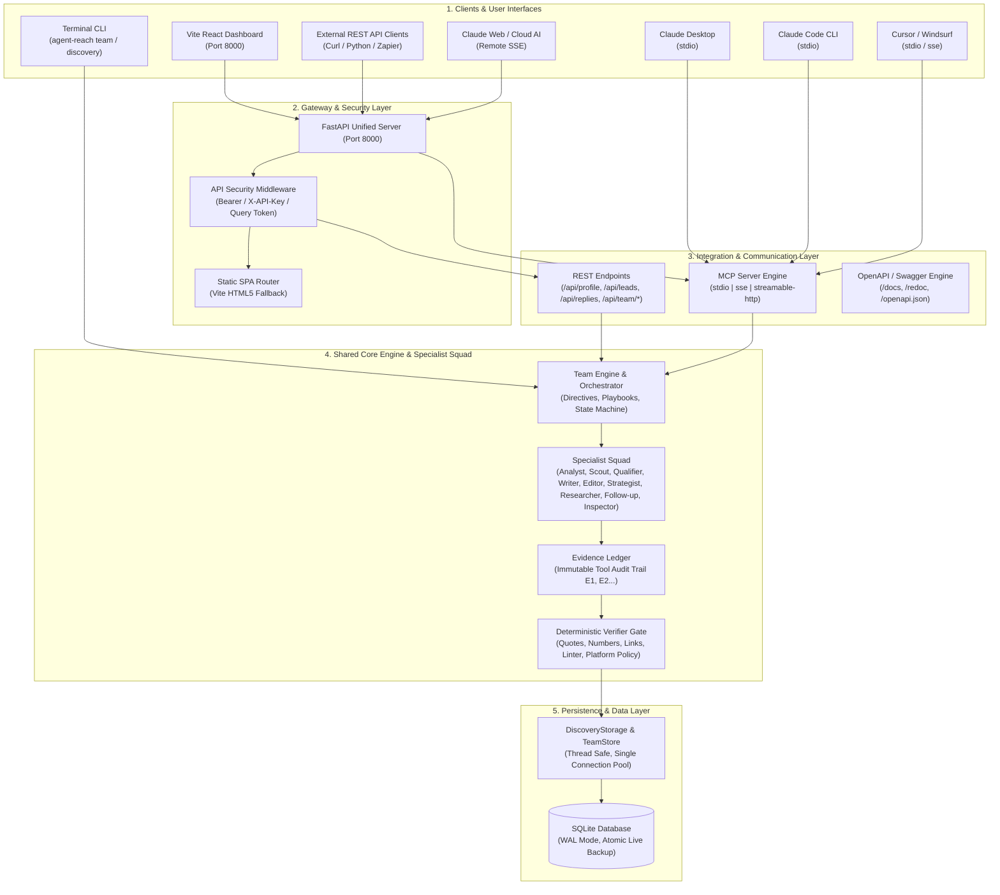
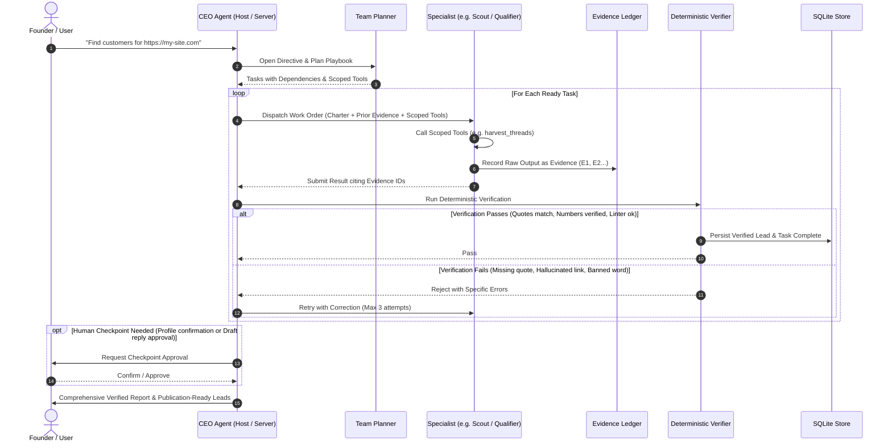
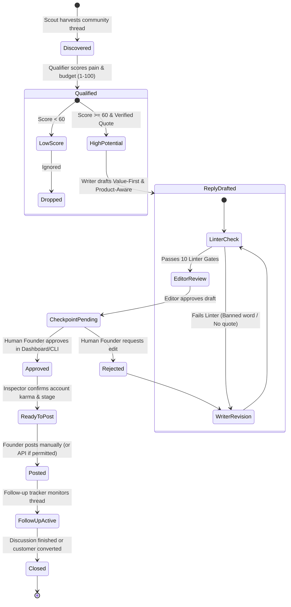

# Agent Reach

[](pyproject.toml)
[](LICENSE)
[](pyproject.toml)
[](https://modelcontextprotocol.io)
[](https://fastapi.tiangolo.com)
[](frontend)

**Agent Reach** is an autonomous AI customer discovery and community marketing platform. You talk to one person: the **CEO**. The CEO interprets your directive, drafts work orders for specialized AI agents (Analyst, Scout, Qualifier, Writer, Editor, Strategist, Researcher, Follow-up Tracker, Inspector), and enforces a deterministic verifier gate before any lead or reply is presented to you.

Agent Reach can be used in whatever way fits your personal workflow: as a **standalone interactive web dashboard**, a **multi-transport MCP server** for Claude and Cursor, a **headless REST API**, or an **interactive terminal CLI**.

---

## System Architecture (UML Component Diagram)

The entire platform shares a single Python core engine, a unified SQLite database (with WAL mode, atomic live backup, and single-connection pooling), and shared safety gates across all interfaces:



---

## Lifecycle of a Directive (UML Sequence Diagram)

Every customer discovery request runs through an anti-hallucination pipeline where unverified claims cannot reach the human owner:



---

## Choose Your Style: How to Use Agent Reach

Agent Reach supports **8 operating modes** to match your exact workflow. Pick the style that fits you:

| Style | Persona / Workflow | Interface | How to Launch |
| :--- | :--- | :--- | :--- |
| **Style 1** | **The Visual Founder** | Modern Web Dashboard | `agent-reach dashboard` |
| **Style 2** | **The Terminal Specialist** | Autonomous CLI & Pipeline | `agent-reach team` / `agent-reach discovery` |
| **Style 3** | **The Claude Desktop User** | Local Desktop AI Assistant | `agent-reach mcp` (stdio) |
| **Style 4** | **The Claude Code Hacker** | CLI Terminal Coding Agent | `claude mcp add agent-reach` |
| **Style 5** | **The REST API Integrator** | Headless Backend & Webhooks | FastAPI at `http://localhost:8000/docs` |
| **Style 6** | **The Cloud / Remote AI User** | Remote Web MCP Client | `agent-reach mcp --transport sse` |
| **Style 7** | **The IDE Copilot User** | Cursor & Windsurf IDE | `.cursor/mcp.json` configuration |

---

### Style 1: The Visual Founder (Web Dashboard)

*Best for founders, marketers, and operators who want a rich, interactive visual dashboard to manage campaigns, monitor the squad in real-time, and approve replies with one click.*

1. **Install with dashboard support:**
   ```bash
   pip install "agent-reach[dashboard]"
   ```

2. **Launch the server & web app:**
   ```bash
   agent-reach dashboard --port 8000
   ```

3. **Open in your browser:**
   ```
   http://localhost:8000
   ```

**What you get:**
- **Overview:** Live company status, active directives, and high-potential lead summaries.
- **CEO Chat & Squad Tracker:** Real-time visibility into what the Analyst, Scout, Qualifier, and Writer are working on.
- **Leads Kanban & Table:** Sort leads by qualification score, purchase intent, and community.
- **Reply Studio:** Side-by-side comparison of **Value-First** vs **Product-Aware** drafts with real-time linter verification.
- **Settings & AI Client Configs:** One-click copy snippets for Claude Desktop, Claude Code, Cursor, and Remote MCP.

---

### Style 2: The Terminal Specialist (Power User CLI)

*Best for developers and automation engineers who live in the terminal and want fast, scriptable control.*

#### Option A: Autonomous Team Mode (Talk to the CEO)
The CEO manages the specialist squad automatically using your configured LLM (`ANTHROPIC_API_KEY`, `OPENAI_API_KEY`, `GEMINI_API_KEY`, `GROQ_API_KEY`, or `DEEPSEEK_API_KEY`):

```bash
# 1. Ask the CEO to start a directive
agent-reach team ask "Find customers for https://my-saas.com"

# 2. Check live progress across all tasks
agent-reach team status

# 3. Approve checkpoints (e.g., profile confirmation)
agent-reach team checkpoint <TASK_ID> approve --message "Target audience is accurate."

# 4. View verified executive report and lead cards
agent-reach team report <DIRECTIVE_ID>
```

#### Option B: Granular Step-by-Step Pipeline
Run discrete discovery stages individually with machine-readable JSON output:

```bash
# Extract business profile from your landing page
agent-reach discovery profile --url https://my-saas.com --confirm

# Link your Reddit handle to calibrate your account karma and stage
agent-reach discovery accounts link reddit:my_handle

# Clone your authentic voice style from your historical posts
agent-reach discovery voice --from-account reddit:my_handle

# Set community self-promotion rules for target subreddits
agent-reach discovery rules set r/saas --self-promo thread_only --ai-content no

# Search communities for pain points and solution requests
agent-reach discovery search --max 15 --communities r/saas,r/entrepreneur

# Filter qualified leads by minimum score
agent-reach discovery leads --min-score 70

# Draft value-first and product-aware replies
agent-reach discovery reply <LEAD_ID>

# Approve and get the direct link to post
agent-reach discovery approve <REPLY_ID> --version value_first
agent-reach discovery post <REPLY_ID>
```

---

### Style 3: The Claude Desktop User (Local MCP)

*Best for users who want to converse with Claude Desktop and have Claude autonomously research leads, qualify threads, and draft replies using Agent Reach tools.*

1. **Generate the configuration snippet automatically:**
   ```bash
   agent-reach mcp config claude-desktop
   ```

2. **Add to your Claude Desktop config:**
   - **macOS:** `~/Library/Application Support/Claude/claude_desktop_config.json`
   - **Windows:** `%APPDATA%\Claude\claude_desktop_config.json`

   ```json
   {
     "mcpServers": {
       "agent-reach": {
         "command": "agent-reach",
         "args": ["mcp"]
       }
     }
   }
   ```

3. **Restart Claude Desktop and ask:**
   > *"Use Agent Reach to discover customers for https://my-site.com on Reddit and Hacker News."*

*Claude will interact with the 13 CEO tools in Company Mode, delegating work to specialists and presenting verified lead cards directly inside your chat.*

---

### Style 4: The Claude Code Hacker (CLI AI Agent)

*Best for developers utilizing Anthropic's Claude Code CLI who want agentic customer discovery natively in their coding terminal.*

1. **Register Agent Reach with Claude Code in one command:**
   ```bash
   claude mcp add agent-reach -- agent-reach mcp
   ```

2. **Or print the command using the CLI helper:**
   ```bash
   agent-reach mcp config claude-code
   ```

3. **In Claude Code:**
   ```
   > /mcp
   > Use Agent Reach to analyze competitors for https://my-saas.com and draft community replies
   ```

---

### Style 5: The Headless REST API Integrator

*Best for backend engineers connecting Agent Reach to custom CRMs, internal admin portals, Zapier, or Slack bots.*

1. **Start the API server (optionally set `AGENT_REACH_API_KEY` for bearer authentication):**
   ```bash
   export AGENT_REACH_API_KEY="sk_live_secret_key_123"
   agent-reach dashboard --port 8000 --host 0.0.0.0
   ```

2. **Explore the Interactive Swagger API Docs:**
   Open `http://localhost:8000/docs` or `http://localhost:8000/redoc`.

3. **Example API Requests:**

   **System Health Check:**
   ```bash
   curl http://localhost:8000/api/health
   # {"status":"ok","version":"3.4.0","database":"ok"}
   ```

   **Retrieve High-Potential Leads:**
   ```bash
   curl -H "X-API-Key: sk_live_secret_key_123" \
        http://localhost:8000/api/leads?min_score=70
   ```

   **Submit CEO Directive via API:**
   ```bash
   curl -X POST http://localhost:8000/api/team/directives \
        -H "X-API-Key: sk_live_secret_key_123" \
        -H "Content-Type: application/json" \
        -d '{"message": "Find customers for https://my-saas.com"}'
   ```

---

### Style 6: The Remote AI User (Claude Web & Remote MCP)

*Best for hosted deployments on a VPS, AWS EC2, or Railway, connecting remote web clients via Server-Sent Events (SSE).*

1. **Option A: Run unified (Dashboard + Remote MCP on port 8000):**
   ```bash
   agent-reach dashboard --port 8000 --host 0.0.0.0
   ```
   *Your Remote MCP endpoint is immediately live at:*
   `https://your-server-domain.com/mcp/sse`

2. **Option B: Run a dedicated standalone SSE MCP Server:**
   ```bash
   agent-reach mcp --transport sse --host 0.0.0.0 --port 8001
   ```

3. **Inspect the remote configuration format:**
   ```bash
   agent-reach mcp config remote --url https://your-server-domain.com/mcp/sse
   ```

---

### Style 7: The IDE Copilot (Cursor & Windsurf)

*Best for software engineers who want market intelligence and customer pain-point discovery right inside their code editor.*

1. **Generate the configuration snippet:**
   ```bash
   agent-reach mcp config cursor
   # or
   agent-reach mcp config windsurf
   ```

2. **Add to `.cursor/mcp.json` in your project root:**
   ```json
   {
     "mcpServers": {
       "agent-reach": {
         "command": "agent-reach",
         "args": ["mcp"]
       }
     }
   }
   ```

3. **In Cursor Composer / Agent:**
   > *"Run an Agent Reach customer discovery pass on our new pricing model and check what users on r/SaaS complain about."*

---

## Lead Lifecycle & Verification (UML State Diagram)



---

## The 9 Specialist Roles

Every specialist is bound to a strict role charter and scoped toolset:

| Specialist | Role & Responsibilities | Scoped Tools |
| :--- | :--- | :--- |
| **Analyst** | Crawls landing pages; extracts value propositions, pain vocabulary, and ICP boundaries. | `reach_fetch_site_text`, `reach_save_business_profile` |
| **Scout** | Generates multi-angle search queries; harvests un-answered threads across Reddit, HN, GitHub, and web forums. | `reach_read_business_profile`, `reach_plan_searches`, `reach_harvest_threads` |
| **Qualifier** | Scores buyer readiness using a 5-dimension rubric; validates evidence quotes against thread text. | `reach_read_thread`, `reach_save_lead`, `reach_list_leads`, `reach_set_lead_status` |
| **Writer** | Generates authentic replies in your voice (**Value-First** and **Product-Aware**); enforces zero AI tells. | `reach_reply_context`, `reach_lint_reply`, `reach_save_reply`, `reach_import_voice` |
| **Editor** | Second-opinion review; inspects tone, relevance, and over-pitching; rejects weak drafts. | `reach_list_leads`, `reach_lint_reply`, `reach_read_thread` |
| **Strategist** | Reviews weekly pipeline health, lead conversion rates, and account safety standing. | `reach_read_business_profile`, `reach_list_leads`, `reach_insights`, `reach_account_health` |
| **Researcher** | Conducts deep competitor research and extracts verified market claims. | `reach_fetch_site_text`, `reach_read_business_profile` |
| **Follow-up** | Monitors posted threads for new replies, updates lead status, and tracks conversations. | `reach_read_thread`, `reach_list_leads`, `reach_set_lead_status` |
| **Inspector** | Non-model deterministic guardian; evaluates account karma, posting ratio, and community compliance. | Internal deterministic verification engine |

---

## Account Health & Platform Safety

Agent Reach is built around sustainable community participation. It strictly enforces a 4-tier account ladder to protect your online reputation:

| Account Tier | Minimum Requirements | Maximum Allowed Pitch Level | Permitted Actions |
| :--- | :--- | :--- | :--- |
| **1. Build** | Age < 30 days or Karma < 100 | **Level 0: Help Only** | Provide pure objective value. Never name your product or link. |
| **2. Trusted** | Age ≥ 30 days and Karma ≥ 100 | **Level 1: Category Mention** | Mention the category of solution. No product name. |
| **3. Established** | Age ≥ 90 days and Karma ≥ 300 | **Level 2: Name Product** | Name product once naturally with clear first-person disclosure. No links. |
| **4. Veteran** | Age ≥ 180 days and Karma ≥ 500 | **Level 3: Name & Link** | Include product link only when the original poster explicitly asks for recommendations. |

*Safety Rule: If more than 10% of an account's recent comments promote a product, its tier automatically drops by one level.*

---

## Environment Configuration (`.env`)

Every configuration parameter is optional. Create a `.env` file in the project root:

```env
# --- LLM Providers (Required for Autonomous CLI / Server Model; Not needed for MCP host mode) ---
ANTHROPIC_API_KEY=
OPENAI_API_KEY=
GEMINI_API_KEY=
GROQ_API_KEY=
DEEPSEEK_API_KEY=
LLM_PROVIDER=anthropic

# --- Search Providers (Falls back to Exa and DuckDuckGo if unset) ---
SERPER_API_KEY=
BRAVE_API_KEY=
TAVILY_API_KEY=

# --- Database & Storage ---
AGENT_REACH_DISCOVERY_DB=~/.agent-reach/discovery.db

# --- API & Dashboard Security ---
AGENT_REACH_API_KEY=your_optional_secret_api_key
ALLOWED_ORIGINS=http://localhost:8000,http://127.0.0.1:8000

# --- Platform Posting (Manual by default; API posting requires explicit approval) ---
AGENT_REACH_ALLOW_AUTOPOST=0
REDDIT_CLIENT_ID=
REDDIT_CLIENT_SECRET=
REDDIT_USERNAME=
REDDIT_PASSWORD=
GITHUB_TOKEN=

# --- YouTube Integration (Optional) ---
YOUTUBE_API_KEY=
YOUTUBE_DAILY_QUOTA=9000
```

---

## Development & Verification

Run the full automated test suite and verification scripts:

```bash
# 1. Install development dependencies
pip install -e ".[dev]"

# 2. Run the unit and integration test suite (211+ tests)
python -m pytest tests -q

# 3. Verify all 8 operating modes end-to-end
python scripts/verify_all_modes.py

# 4. Validate skill manifests and references
python scripts/validate_skills.py

# 5. Check tool reference synchronization
python scripts/gen_tool_reference.py --check
```

---

## License

MIT License. Designed and engineered for high-integrity, high-value customer discovery.
